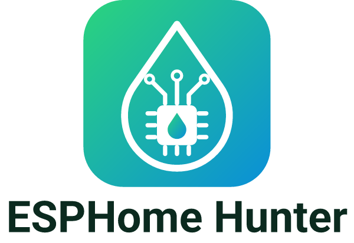
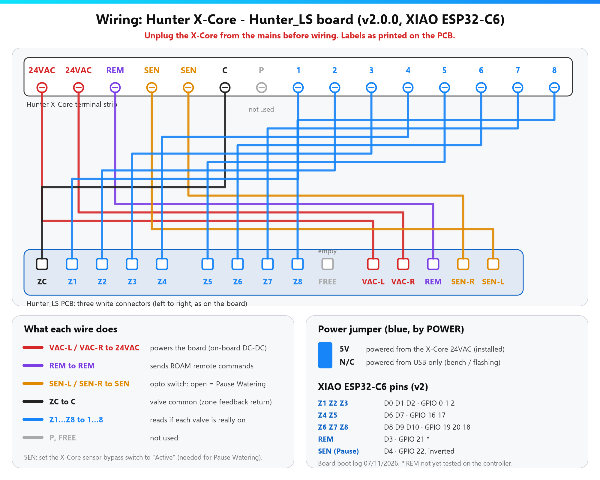

  <picture>
    <source media="(prefers-color-scheme: dark)" srcset="docs/img/logo-dark.png">
    <source media="(prefers-color-scheme: light)" srcset="docs/img/logo-light.png">
    
  </picture>

<b>Like it? Help me build something better.</b> 
  
  

  
  
  
  

<b>Your Hunter X-Core irrigation controller in Home Assistant. Plug in by USB, click Install, done. No YAML.</b> 
🇵🇹 <a href="README.pt.md">Ler em português</a>

  

  

## Compatibility

**Luís Soares's Hunter_LS boards** only — **v1.x** (Wemos D1 mini, 4 zones) or **v2.0.0** (XIAO ESP32-C6, up to 8 zones) — in a Hunter controller with REM, SEN and zone terminals (e.g. X-Core).  
Details: [overview](docs/overview.md) · [hardware & pins](docs/hardware.md)

## Install in 3 steps

1. **Flash** — Open the **[web installer](https://skydoy.github.io/ESPHOME_Hunter/)**, pick your board, plug in by USB → **Install**.
2. **Wi-Fi** — Type your 2.4 GHz network in the same window (or join `ESPHome Hunter Setup` later).
3. **Fit and add** — Unplug the X-Core, set the sensor switch to **Active**, fit the board ([wiring](docs/hardware.md#wiring)), plug it back in. Home Assistant → **Configure**.

Pictures: [Quick start](docs/quick-start.md)

## What you get

- Start / stop each zone and see the **real** valve state
- Programs A / B / C and **Stop All** (same as the X-Core buttons)
- **Pause Watering** — blocks all watering (like a rain sensor)
- Configurable run time (1–240 min)
- One-click firmware updates (or Auto Update at night)
- Device web page on your LAN (`http://<device-ip>/`) — [screenshots](docs/web-page.md)

## Docs & more

[Documentation site](https://skydoy.github.io/ESPHOME_Hunter/docs/) ·
[Overview (boards, OTA, credits)](docs/overview.md) ·
[Quick start](docs/quick-start.md) ·
[Hardware & pins](docs/hardware.md) ·
[Configuration](docs/configuration.md) ·
[Troubleshooting](docs/troubleshooting.md) ·
[Device web page](docs/web-page.md) ·
[Security & OTA](docs/security.md) ·
[Changelog](CHANGELOG.md) ·
[Report a problem](https://github.com/skydoy/ESPHOME_Hunter/issues)

[PolyForm Noncommercial 1.0.0](LICENSE) — free for personal and non-commercial use; commercial use not permitted.  
[Security policy](SECURITY.md) · [Third-party notices](THIRD_PARTY_NOTICES.md)
