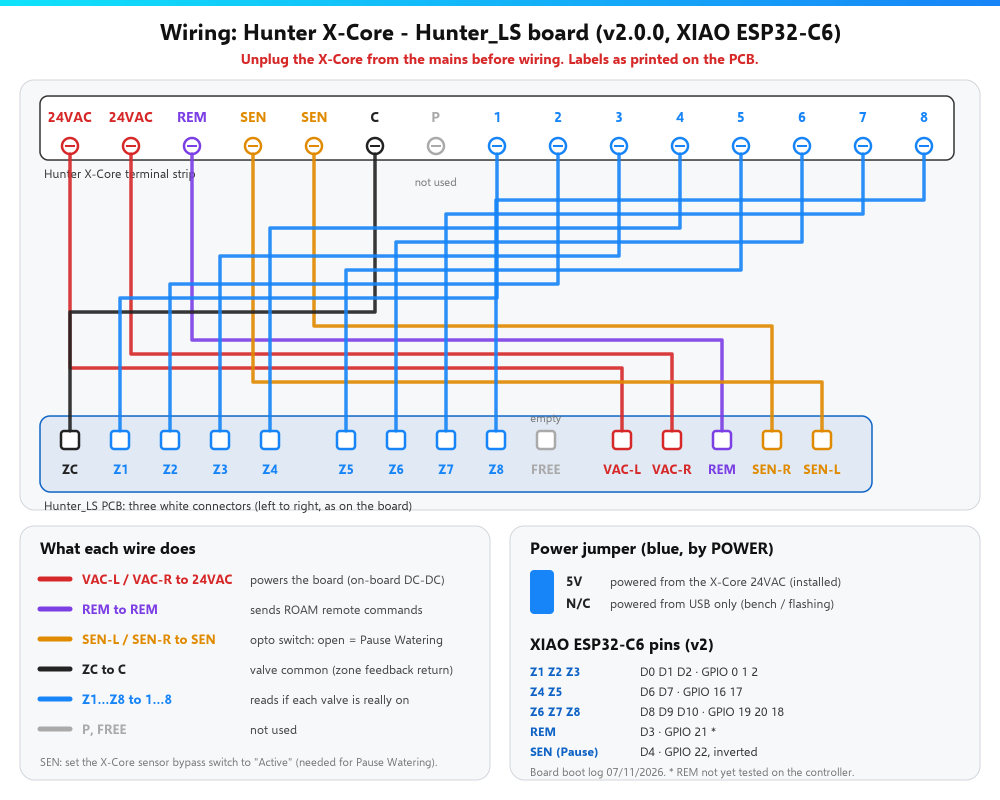

  <picture>
    <source media="(prefers-color-scheme: dark)" srcset="docs/img/logo-dark.png">
    <source media="(prefers-color-scheme: light)" srcset="docs/img/logo-light.png">
    
  </picture>

<b>Gostas? Ajuda-me a fazer algo ainda melhor.</b> 
  
  

  
  
  
  

<b>O teu programador de rega Hunter X-Core no Home Assistant. Liga por USB, carrega em Instalar, feito. Sem YAML.</b> 
🇬🇧 <a href="README.md">Read in English</a>

  

  

## Compatibilidade

Só as **placas Hunter_LS do Luís Soares** — **v1.x** (Wemos D1 mini, 4 zonas) ou **v2.0.0** (XIAO ESP32-C6, até 8 zonas) — num programador Hunter com terminais REM, SEN e das zonas (ex.: X-Core).  
Detalhes: [visão geral](docs/visao-geral.md) · [hardware e pinos](docs/hardware.md)

## Instalar em 3 passos

1. **Instalar o firmware** — Abre o **[instalador web](https://skydoy.github.io/ESPHOME_Hunter/)**, escolhe a placa, liga por USB → **Instalar**.
2. **Wi-Fi** — Escreve a tua rede de 2,4 GHz na mesma janela (ou liga-te depois a `ESPHome Hunter Setup`).
3. **Montar e adicionar** — Desliga o X-Core, põe o interruptor do sensor em **Active**, monta a placa ([ligações](docs/hardware.md#wiring)), volta a ligar. Home Assistant → **Configurar**.

Com imagens: [Guia rápido](docs/guia-rapido.md)

## O que obténs

- Ligar / parar cada zona e ver o estado **real** da válvula
- Programas A / B / C e **Stop All** (iguais aos botões do X-Core)
- **Pause Watering** — bloqueia toda a rega (como um sensor de chuva)
- Tempo de rega configurável (1–240 min)
- Atualizações de firmware com um clique (ou Auto Update de madrugada)
- Página web da placa na tua LAN (`http://<ip-da-placa>/`) — [capturas](docs/pagina-web.md)

## Documentação e mais

[Site de documentação](https://skydoy.github.io/ESPHOME_Hunter/docs/pt/) ·
[Visão geral (placas, OTA, créditos)](docs/visao-geral.md) ·
[Guia rápido](docs/guia-rapido.md) ·
[Hardware e pinos](docs/hardware.md) ·
[Configuração](docs/configuration.md) ·
[Problemas](docs/problemas.md) ·
[Página web da placa](docs/pagina-web.md) ·
[Segurança e OTA](docs/seguranca.md) ·
[Alterações](CHANGELOG.md) ·
[Reportar um problema](https://github.com/skydoy/ESPHOME_Hunter/issues)

[PolyForm Noncommercial 1.0.0](LICENSE) — gratuito para uso pessoal e não comercial; uso comercial não permitido.  
[Política de segurança](SECURITY.md) · [Avisos de terceiros](THIRD_PARTY_NOTICES.md)
