  <picture>
    <source media="(prefers-color-scheme: dark)" srcset="docs/img/logo-dark.png">
    <source media="(prefers-color-scheme: light)" srcset="docs/img/logo-light.png">
    
  </picture>

<b>❤️ Gostas? Ajuda-me a trazer algo ainda melhor.</b> 
  
  

<b>O teu programador de rega Hunter X-Core no Home Assistant. Ligar, carregar em Instalar, feito. Sem YAML.</b> 
🇬🇧 <a href="README.md">Read in English</a>

  

  

Firmware para a **[placa Hunter_LS do Luís Soares](docs/original-hunter-ls.md)**, uma pequena PCB que
cabe dentro do X-Core, liga as zonas como o comando Hunter e confirma se cada válvula abriu mesmo.
Tudo local: sem nuvem, sem app, sem conta.

## Instalar em 3 passos
1. **Instalar o firmware.** Abre o **[instalador web](https://skydoy.github.io/ESPHOME_Hunter/)** no Chrome ou Edge,
   escolhe a placa (a versão está impressa na PCB), liga o ESP ao computador por USB → **Instalar**.
2. **Wi-Fi.** Escreve o teu Wi-Fi na mesma janela. (Ou mais tarde: liga-te à rede `ESPHome Hunter Setup` com o telemóvel.)
3. **Montar e adicionar.** Desliga o X-Core da tomada, põe o interruptor do sensor em **Active**, monta a placa e volta a ligar.
   O Home Assistant mostra *ESPHome Hunter* em **Definições → Dispositivos e serviços** → **Configurar**.

A imagem mostra o X-Core e as zonas. Onde vai cada fio da Hunter_LS:

| Hunter_LS (legenda na PCB) | Terminal do X-Core | Para que serve |
|---|---|---|
| VAC-L, VAC-R | 24VAC, 24VAC | Alimenta a placa |
| REM | REM | Comandos do comando ROAM |
| SEN-L, SEN-R | SEN, SEN | *Pause Watering* (põe o interruptor do sensor em **Active**) |
| ZC | C | Comum das válvulas (retorno do feedback) |
| Z1 … Z8 | 1 … 8 | Feedback das válvulas (v1: só Z1–Z4) |

Jumper de alimentação (azul): **5V** com a placa no X-Core; **N/C** só para gravar por USB.
Mais detalhe: **[Hardware e pinos](docs/hardware.md#wiring)**.

Passo a passo com fotos: **[Guia rápido](docs/guia-rapido.md)** · **[Quick start (EN)](docs/quick-start.md)**

## O que aparece no Home Assistant
| Entidade | Para que serve |
|---|---|
| **Zone 1 … Zone N** | Liga / desliga uma zona durante *Run Time* minutos. Mostra o estado **real** da válvula. |
| **Watering**, **Active Zone** | Se está a regar, e qual a zona. |
| **Run Time** | Minutos de rega quando ligas uma zona pelo Home Assistant (1–240). |
| **Run Program A / B / C**, **Stop All** | Iguais aos botões do programador. |
| **Pause Watering** | Bloqueia toda a rega, incluindo os programas do X-Core (como um sensor de chuva). |
| **Firmware Update** | Novas versões instalam-se pelo Wi-Fi com um clique. |

## Placas
| | **v2.0.0** (PCB preta) | **v1.x** (v1.0.0 / v1.1.0 / v1.1.1) |
|---|---|---|
| Módulo ESP | Seeed XIAO ESP32-C6 | Wemos D1 mini (ESP8266) |
| Zonas | até 8 (2/4/6/8) | 4 |
| Configurar o Wi-Fi | USB, Bluetooth ou hotspot | USB ou hotspot |

> **Estado:** a v0.1.0 é compilada e verificada automaticamente, mas ainda não foi testada numa placa real.
> Os pinos da v2.0.0 vêm do firmware do próprio Luís. Experimentaste? [Conta-nos](https://github.com/skydoy/ESPHOME_Hunter/issues).

## Compatibilidade
Este firmware só funciona com as **placas Hunter_LS do Luís Soares** (v1.x: Wemos D1 mini / ESP8266; v2.0.0: Seeed XIAO ESP32-C6), montadas num **programador Hunter** que tenha terminais REM, SEN e das zonas — por exemplo o Hunter X-Core (até 8 zonas na v2). Outras placas ou controladores não são suportados.

## Atualizações automáticas (OTA)
Não precisas de fazer nada: com a **Atualização automática** ligada (é o predefinido), a placa
procura uma versão nova uma vez por noite às 03:MM (minuto ao acaso, para não carregarem todas
ao mesmo tempo) e instala-a. Também verifica ao arrancar e a cada 6 horas. Só são oferecidas
versões testadas, do ramo `stable`.
- **Instalada pelo instalador web:** o Home Assistant mostra um cartão **Firmware Update**
  (Definições → Atualizações). Também tens **Verificar atualizações**, **Instalar atualização** e
  **Estado da atualização** no dispositivo. Carrega em **Instalar**, espera 1–2 minutos e não
  desligues o programador. O Wi-Fi e as zonas mantêm-se.
- **Adotada no ESPHome Device Builder:** a placa só *avisa* que há versão nova
  (*Update Available*, *Check for Update*, *Update Status*). Carrega em **Install** no Device
  Builder; a tua configuração já segue o `stable`, não precisas de mexer no YAML.
- **Avisar-me:** importa o blueprint do Home Assistant
  `blueprints/automation/esphome_hunter_update_available.yaml` para receberes uma notificação no
  telemóvel quando *Update Available* passar a ligado.
- **v1 (ESP8266):** não consegue verificar o certificado HTTPS ao descarregar. Funciona na mesma,
  mas, se preferires, atualiza por USB no [instalador](https://skydoy.github.io/ESPHOME_Hunter/).

## Histórico de alterações
Última versão: **v0.1.11** – esquema de ligações simplificado do X-Core (zonas 1–8, animado) nos READMEs e no instalador web.
Todas as versões: [CHANGELOG.md](CHANGELOG.md).

## Documentação
[Problemas](docs/problemas.md) · [Troubleshooting (EN)](docs/troubleshooting.md) ·
[Configuração avançada (EN)](docs/configuration.md) · [Hardware e pinos (EN)](docs/hardware.md) ·
[Alterações](CHANGELOG.md) · [Reportar um problema](https://github.com/skydoy/ESPHOME_Hunter/issues)

## Créditos
- **Hardware: Luís Soares**, placa Hunter_LS.
  A PCB, as versões e as fotos são trabalho dele. [README original do Luís](docs/original-hunter-ls.md)
  (inclui como obter uma placa) · [fotos](hardware/).
- Esquema e abordagem ESPHome original: **CZSmith**, HunterMonitor (MIT, ver [THIRD_PARTY_NOTICES.md](THIRD_PARTY_NOTICES.md)).
- Drivers do protocolo Hunter ROAM: Hunter_Roam de javiervidao (v1.x) e
  Hunter_ESP_IDF de Luís Soares (v2.0.0).
- Firmware, instalador e logótipo: skydoy.

## Licença
[PolyForm Noncommercial 1.0.0](LICENSE): gratuito para uso pessoal e não comercial, forks
bem-vindos, uso comercial não permitido. Cobre só o firmware, a configuração, o instalador e a
documentação deste repositório — não o hardware Hunter_LS do Luís, nem o código de terceiros
(ver [THIRD_PARTY_NOTICES.md](THIRD_PARTY_NOTICES.md)). Usa por tua conta e risco: o X-Core tem
tensão da rede lá dentro.

Hunter e X-Core são marcas registadas da Hunter Industries. Projeto comunitário independente,
sem ligação nem aprovação da Hunter Industries.
