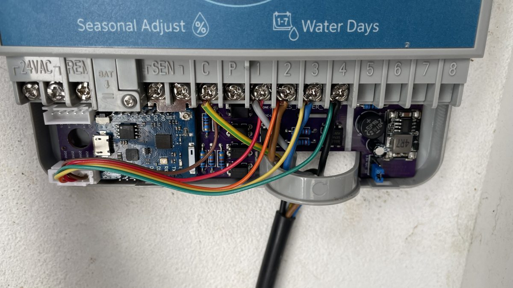
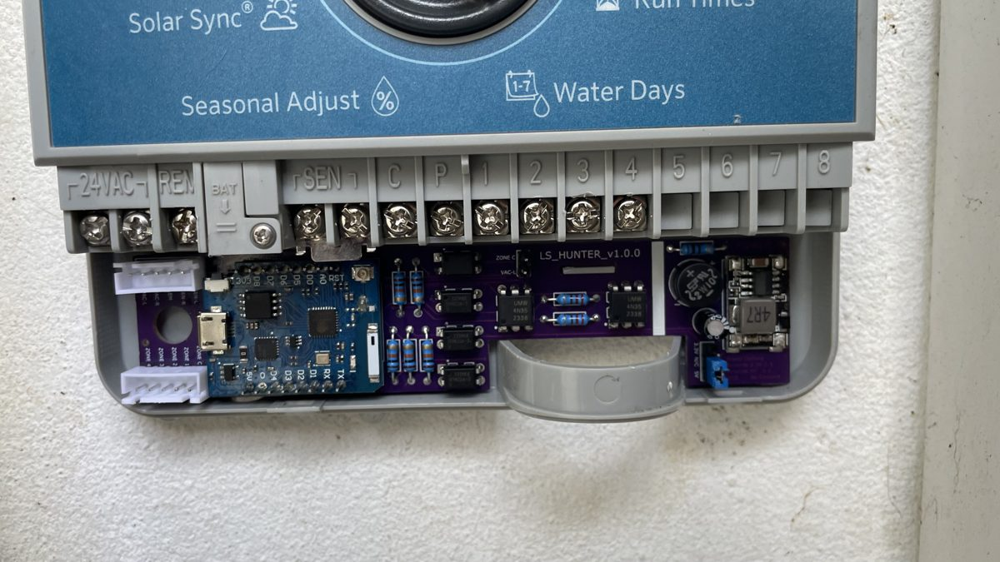

# Guia rápido

Da caixa ao Home Assistant em cerca de 10 minutos, sem YAML. *English: [quick-start.md](quick-start.md).*

## Precisa de
- Uma placa **Hunter_LS** (a versão está impressa na PCB: v1.0.0, v1.1.0, v1.1.1 ou v2.0.0).
- Um computador com **Chrome ou Edge** e um cabo USB **de dados** (USB-C na v2.0.0, micro-USB na v1.x).
- O nome e a palavra-passe do Wi-Fi de casa (rede de **2,4 GHz**).
- Home Assistant (a integração ESPHome é sugerida automaticamente).

## 1. Instalar o firmware (2 minutos)
Faça isto **antes de montar a placa no X-Core** (ou com o X-Core desligado da tomada).
1. Abra **https://skydoy.github.io/ESPHOME_Hunter/**.
2. Escolha a placa: **v2.0.0** (PCB preta, XIAO ESP32-C6) ou **v1.x** (Wemos D1 mini).
3. Ligue o módulo ESP ao computador por USB.
4. Carregue em **Instalar**, escolha a porta ("USB JTAG/serial debug unit" na v2.0.0, "CH340"/"CP210x" na v1.x) → **Install**.

✅ *Deve ver:* uma barra de progresso e depois "Installation complete!".

## 2. Wi-Fi (1 minuto)
- Logo a seguir, a mesma janela pede o Wi-Fi: escolha a rede, escreva a palavra-passe → **Connect**.
- Saltou este passo? No telemóvel ligue-se à rede **`Hunter-LS Setup`**; abre-se uma página, escolha o seu Wi-Fi.
  Esta rede volta a aparecer sozinha sempre que a placa não conseguir ligar ao Wi-Fi guardado.
- Só na v2.0.0: também pode configurar o Wi-Fi por Bluetooth na app do Home Assistant.

✅ *Deve ver:* "Connected" e um botão **Visit device**. O LED deixa de piscar.

## 3. Montar a placa no X-Core (5 minutos)
1. **Desligue o transformador do X-Core da tomada.**
2. Ponha o **interruptor do sensor do X-Core em "Active"** (sem isto a *Pause Watering* não faz nada).
3. Ligue os fios da placa aos terminais do X-Core seguindo as legendas impressas na placa (zonas, VAC, REM, SEN).
4. Volte a ligar o transformador.

*Fotos do Luís Soares (placa v1.0.0; as outras versões montam-se da mesma forma). Mais fotos em [hardware/](../hardware/).*

## 4. Adicionar ao Home Assistant (1 minuto)
**Definições → Dispositivos e serviços**: aparece **Hunter Irrigation** em *Descobertos* → **Configurar**.
Dê-lhe uma divisão (ex.: Jardim).

**Teste:** ponha **Run Time** a 1, ligue a **Zone 1** e confirme que a válvula abre e que o
interruptor fica ligado. Se voltar a desligar-se sozinho passado um segundo, veja [problemas.md](problemas.md).

| Entidade | Para que serve |
|---|---|
| **Zone 1 … Zone N** | Liga/desliga a zona durante *Run Time* minutos e mostra o estado **real** da válvula. |
| **Watering** / **Active Zone** | Se está a regar e qual a zona. |
| **Run Program A/B/C**, **Stop All** | Iguais aos botões do programador. |
| **Pause Watering** | Bloqueia toda a rega (como um sensor de chuva) até ser desligado. |
| **Firmware Update** | Instala novas versões pelo Wi-Fi. |

Na v2.0.0 aparecem 8 zonas; se o seu X-Core tiver menos, desative as que não usa no Home Assistant
(ou mude `zone_count`, ver [configuration.md](configuration.md)).

## 5. Atualizações
Quando sair uma versão nova aparece **Firmware Update** no Home Assistant → **Instalar**. Mais nada.

Algum problema? Ver **[problemas.md](problemas.md)**.
