# Hardware and pin map

The Hunter_LS PCB is designed by **Luís Soares** (Hunter_LS)
following **CZSmith**'s HunterMonitor schematic:
- **REM**: the ESP sends Hunter ROAM remote commands to the X-Core's REM terminal through an opto-coupler.
- **Zone feedback**: each valve output (24 V AC) drives an opto-coupler, so the ESP sees whether the valve is really powered.
- **SEN**: an opto-isolated switch in the rain-sensor loop; opening it blocks all watering (*Pause Watering*).
- On-board DC-DC converter powered from the X-Core's 24 V AC; a jumper selects external/USB power.

## Wiring

The picture shows the X-Core and its zones. The table below says where each Hunter_LS wire goes (same table as in the READMEs and the web installer).

> ⚠️ Unplug the X-Core transformer from the mains before wiring. The board only touches the 24 V AC side.

| Hunter_LS connector (PCB label) | X-Core terminal | What it does |
|---|---|---|
| VAC-L, VAC-R | 24VAC, 24VAC | Powers the board through its on-board DC-DC converter |
| REM | REM | ROAM remote commands to the controller |
| SEN-L, SEN-R | SEN, SEN | Opto-isolated switch in the sensor loop: open = *Pause Watering*. Set the X-Core sensor bypass switch to **Active** |
| ZC | C | Valve common, return for the zone feedback |
| Z1 … Z8 | 1 … 8 | Feedback: is each valve really powered (v1: Z1–Z4 only) |
| FREE | – | Not used (X-Core **P** is not used either) |

**Power jumper** (blue, next to POWER): **5V** = powered from the X-Core 24 V AC (normal, installed);
**N/C** = powered by USB only, for flashing on the bench. Labels as printed on the PCB. Connect only the zones you use.

v2 pins were confirmed from the board's own boot log on 7 Nov 2026 (zones and SEN). REM (GPIO21) is
not yet tested with the controller connected.

## v1.x (v1.0.0 / v1.1.0 / v1.1.1) – Wemos D1 mini (ESP8266), 4 zones
Taken from HunterMonitor's `hunter-roam-alt.yaml`. **To be confirmed by Luís for the Hunter_LS PCB.**

| D1 mini pin | Function |
|---|---|
| D2 (GPIO4) | REM (ROAM commands) |
| D1 (GPIO5) | SEN ("Pause Watering") |
| D5 / D6 / D7 (GPIO14/12/13) | Zone 1 / 2 / 3 feedback (inverted, pull-up) |
| A0 | Zone 4 feedback (analog) |
| D4 (GPIO2) | Status LED (on-board) |

ROAM driver: `javiervidao/Hunter_Roam` (Arduino), pinned to commit `7c51ca1`.

## v2.0.0 – Seeed XIAO ESP32-C6, up to 8 zones
Recovered from **Luís Soares's own compiled v2.0.0 firmware** (ESPHome 2026.6.2, project `hunterls8v2`):
the GPIO numbers, directions and inversion are read from his binary. Not yet re-tested on a board
with this firmware; please [report](https://github.com/skydoy/ESPHOME_Hunter/issues) how it goes.

| XIAO pin | GPIO | Function | Confidence |
|---|---|---|---|
| D0 / D1 / D2 | 0 / 1 / 2 | Zone 1 / 2 / 3 feedback (input, pull-up, inverted) | high |
| D3 | 21 | REM (ROAM commands, output) | medium-high |
| D4 | 22 | SEN, *Pause Watering* (output, inverted) | high |
| D5 | 23 | free | – |
| D6 / D7 | 16 / 17 | Zone 4 / 5 feedback | high |
| D8 / D9 / D10 | 19 / 20 / 18 | Zone 6 / 7 / 8 feedback | high |
| – | 15 | Status LED (user LED) | high |
| – | 3 / 14 | RF switch power / antenna select (*External Antenna*) | high |

Also taken from Luís's firmware: after a **cold power-on** the board restarts once after 5 s
(clears a start-up glitch); a normal restart does not.

ROAM driver: `luisfosoares/Hunter_ESP_IDF` (ESP-IDF), pinned to commit `9e765a4`.

## Licences
Neither ROAM driver repository declares a licence, so this repository does not copy their code:
it fetches them as ESPHome `external_components` at a fixed commit.

## Boards at a glance

| | **v2.0.0** (black PCB) | **v1.x** (v1.0.0 / v1.1.0 / v1.1.1) |
|---|---|---|
| ESP module | Seeed XIAO ESP32-C6 | Wemos D1 mini (ESP8266) |
| Zones | up to 8 (2/4/6/8) | 4 |
| Wi-Fi setup | USB, Bluetooth or hotspot | USB or hotspot |
| USB | USB-C | micro-USB |

The version is printed on the PCB. Pick the matching option in the [web installer](https://skydoy.github.io/ESPHOME_Hunter/).
