# Overview

Details that used to live in the root [README](../README.md). Short start: [README](../README.md) · [Quick start](quick-start.md).

## What it is

Firmware for **Luís Soares's Hunter_LS board**, a small PCB that fits inside a Hunter X-Core
irrigation controller, starts zones like the Hunter remote and reads back whether each valve is
really on. Local only: no cloud, no app, no account.

Free for personal and non-commercial use. Forks welcome. Commercial use is not permitted.

**Compatible only** with Luís's Hunter_LS boards (v1.x or v2.0.0) in a Hunter controller that has
REM, SEN and zone terminals — for example the Hunter X-Core. Other boards or controllers are not
supported. See [Hardware & pins](hardware.md).

## What you get in Home Assistant

| Entity | What it does |
|---|---|
| **Zone 1 … Zone N** | Starts / stops a zone for *Run Time* minutes. Shows the **real** valve state. |
| **Watering**, **Active Zone** | Is anything watering, and which zone. |
| **Run Time** | Minutes for a zone started from Home Assistant (1–240). |
| **Run Program A / B / C**, **Stop All** | Same as the controller's buttons. |
| **Pause Watering** | Blocks all watering, including the X-Core's own schedule (like a rain sensor). |
| **Firmware Update**, **Auto Update** | New versions in one click, or by themselves at night. |

The device also has a web page at `http://<device-ip>/` with a PT/EN toggle, a live X-Core wiring
diagram and the update buttons (no password, LAN only; see [Security and OTA](security.md)).

Screenshots: [Device web page](web-page.md).

## Boards

| | **v2.0.0** (black PCB) | **v1.x** (v1.0.0 / v1.1.0 / v1.1.1) |
|---|---|---|
| ESP module | Seeed XIAO ESP32-C6 | Wemos D1 mini (ESP8266) |
| Zones | up to 8 (2/4/6/8) | 4 |
| Wi-Fi setup | USB, Bluetooth or hotspot | USB or hotspot |
| USB | USB-C | micro-USB |

The version is printed on the PCB. Pick the matching option in the
[web installer](https://skydoy.github.io/ESPHOME_Hunter/). Pin map: [hardware.md](hardware.md).

## Automatic updates (OTA)

With **Auto Update** on (the default), the board checks for a new release once a night at 03:MM
local time (a random minute) and installs it. It also checks at start-up and every 6 hours. Only
tested releases from the `stable` branch are offered.
API key, Device Builder vs factory OTA, and the open LAN web page:
[Security and OTA](security.md).

- **Web installer image:** Home Assistant shows **Firmware Update**. Press **Install** (or leave
  **Auto Update** on). Wi-Fi and zones are kept.
- **Adopted in the ESPHome Device Builder:** the board only *reports* a new version
  (**Update Status**, **Check for Update**). Press **Install** in the Device Builder; your
  config already follows `stable`.
- **Notify me:** import `blueprints/automation/esphome_hunter_update_available.yaml`.
- **v1 (ESP8266):** can't verify the HTTPS certificate when downloading; USB from the installer
  works if you prefer.

## Device web page

Open `http://<device-ip>/` on your LAN for the PT/EN toggle, live wiring diagram and update
controls (no password by design; [security notes](security.md)).

Full screenshots: [Device web page](web-page.md).

## Own build / Device Builder

- v2: [devices/hunter-ls-v2.yaml](../devices/hunter-ls-v2.yaml)
- v1: [devices/hunter-ls-v1.yaml](../devices/hunter-ls-v1.yaml)

See [Configuration](configuration.md).

## Credits

- **Hardware: Luís Soares**, Hunter_LS board. The PCB, its versions and photos are his work.
  [His original README](original-hunter-ls.md) (including how to get a board) · [photos](../hardware/).
- Schematic and the original ESPHome approach: **CZSmith**, HunterMonitor (MIT, see
  [THIRD_PARTY_NOTICES.md](../THIRD_PARTY_NOTICES.md)).
- Hunter ROAM drivers: Hunter_Roam by javiervidao (v1.x) and Hunter_ESP_IDF by Luís Soares (v2.0.0),
  used as pinned external components.
- Firmware, installer and logo: skydoy.

[PolyForm Noncommercial 1.0.0](../LICENSE): free for personal and non-commercial use, forks
welcome, commercial use not permitted. Covers this repo's firmware, config, installer and docs
only — not Luís's Hunter_LS hardware design, and not third-party code
([THIRD_PARTY_NOTICES.md](../THIRD_PARTY_NOTICES.md)). Use at your own risk: the X-Core has mains
voltage inside. Hunter and X-Core are trademarks of Hunter Industries. Independent community
project, not affiliated with or endorsed by Hunter Industries.

## More docs

[Troubleshooting](troubleshooting.md) · [Hardware & pins](hardware.md) ·
[Configuration](configuration.md) · [Quick start](quick-start.md) ·
[Changelog](../CHANGELOG.md) · [Security and OTA](security.md) ·
[Report a problem](https://github.com/skydoy/ESPHOME_Hunter/issues) ·
[Security policy](../SECURITY.md) · [Third-party notices](../THIRD_PARTY_NOTICES.md)
