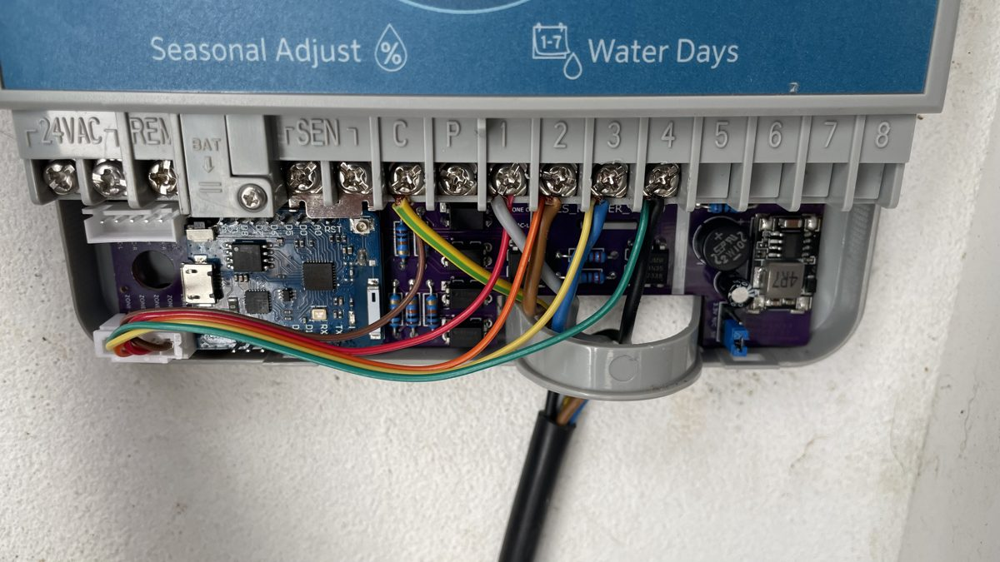
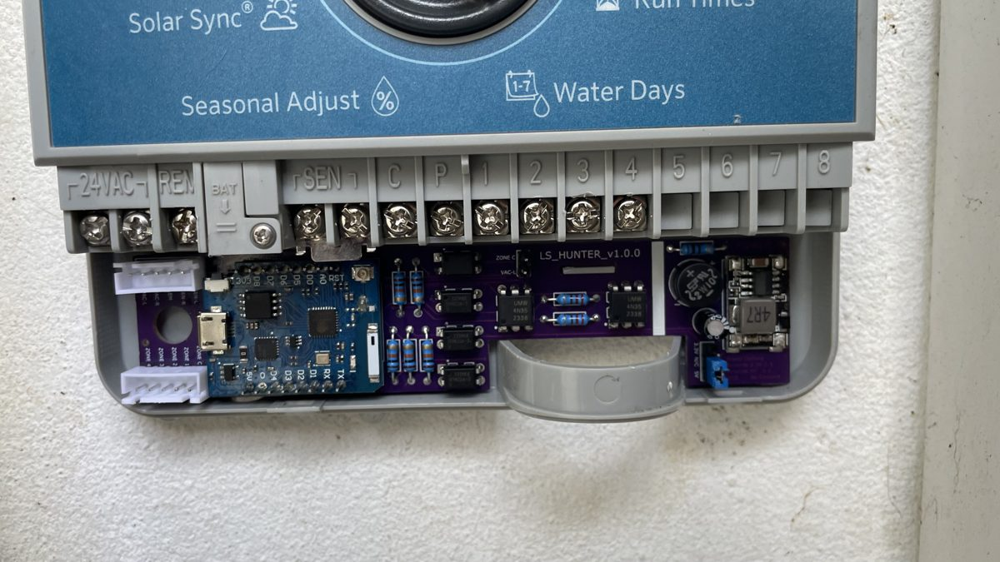

# Quick start

From the box to Home Assistant in about 10 minutes, no YAML. *Português: [guia-rapido.md](guia-rapido.md).*

## You need
- A **Hunter_LS** board (the version is printed on the PCB: v1.0.0, v1.1.0, v1.1.1 or v2.0.0).
- A computer with **Chrome or Edge** and a USB **data** cable (USB-C for v2.0.0, micro-USB for v1.x).
- Your home Wi-Fi name and password (**2.4 GHz** network).
- Home Assistant (the ESPHome integration is suggested automatically).

## 1. Flash the firmware (2 minutes)
Do this **before fitting the board in the X-Core** (or with the X-Core unplugged).
1. Open **https://skydoy.github.io/ESPHOME_Hunter/**.
2. Pick your board: **v2.0.0** (black PCB, XIAO ESP32-C6) or **v1.x** (Wemos D1 mini).
3. Plug the ESP module into your computer by USB.
4. Press **Install**, pick the port ("USB JTAG/serial debug unit" on v2.0.0, "CH340"/"CP210x" on v1.x) → **Install**.

✅ *You should see:* a progress bar, then "Installation complete!".

## 2. Wi-Fi (1 minute)
- Right after flashing, the same window asks for Wi-Fi: pick your network, type the password → **Connect**.
- Skipped it? From your phone join the **`Hunter-LS Setup`** hotspot; a page opens, pick your Wi-Fi.
  The hotspot comes back on its own whenever the board cannot reach the saved Wi-Fi.
- v2.0.0 only: you can also set Wi-Fi over Bluetooth from the Home Assistant app.

✅ *You should see:* "Connected" and a **Visit device** button. The LED stops blinking.

## 3. Fit the board in the X-Core (5 minutes)
1. **Unplug the X-Core transformer.**
2. Set the **X-Core sensor bypass switch to "Active"** (without it *Pause Watering* does nothing).
3. Connect the board's wires to the X-Core terminals following the labels on the board (zones, VAC, REM, SEN).
4. Plug the transformer back in.

*Photos by Luís Soares (v1.0.0 board; the other versions fit the same way). More in [hardware/](../hardware/).*

## 4. Add it to Home Assistant (1 minute)
**Settings → Devices & services**: **Hunter Irrigation** shows up under *Discovered* → **Configure**.
Give it an area (e.g. Garden).

**Test:** set **Run Time** to 1, turn on **Zone 1** and check the valve opens and the switch stays on.
If it turns itself off after a second, see [troubleshooting.md](troubleshooting.md).

| Entity | What it does |
|---|---|
| **Zone 1 … Zone N** | Runs the zone for *Run Time* minutes and shows the **real** valve state. |
| **Watering** / **Active Zone** | Is anything watering, and which zone. |
| **Run Program A/B/C**, **Stop All** | Same as the controller's buttons. |
| **Pause Watering** | Blocks all watering (like a rain sensor) until turned off. |
| **Firmware Update** | Installs new versions over Wi-Fi. |

v2.0.0 shows 8 zones; if your X-Core has fewer, disable the unused ones in Home Assistant
(or change `zone_count`, see [configuration.md](configuration.md)).

## 5. Updates
When a new version is out, **Firmware Update** appears in Home Assistant → **Install**. That's it.

Something wrong? See **[troubleshooting.md](troubleshooting.md)**.
