# Visão geral

Detalhes que estavam no [README em português](../README.pt.md). Começo curto: [README.pt.md](../README.pt.md) · [Guia rápido](guia-rapido.md).

## O que é

Firmware para a **placa Hunter_LS do Luís Soares**, uma pequena PCB que cabe dentro de um
programador de rega Hunter X-Core, liga as zonas como o comando Hunter e confirma se cada válvula
abriu mesmo. Tudo local: sem nuvem, sem app, sem conta.

Gratuito para uso pessoal e não comercial. Forks são bem-vindos. O uso comercial não é permitido.

**Só funciona** com as placas Hunter_LS do Luís (v1.x ou v2.0.0) num programador Hunter com
terminais REM, SEN e das zonas — por exemplo o Hunter X-Core. Outras placas ou controladores não
são suportados. Vê [Hardware e pinos](hardware.md).

## O que aparece no Home Assistant

| Entidade | Para que serve |
|---|---|
| **Zone 1 … Zone N** | Liga / desliga uma zona durante *Run Time* minutos. Mostra o estado **real** da válvula. |
| **Watering**, **Active Zone** | Se está a regar, e qual a zona. |
| **Run Time** | Minutos de rega quando ligas uma zona pelo Home Assistant (1–240). |
| **Run Program A / B / C**, **Stop All** | Iguais aos botões do programador. |
| **Pause Watering** | Bloqueia toda a rega, incluindo os programas do X-Core (como um sensor de chuva). |
| **Firmware Update**, **Auto Update** | Novas versões com um clique, ou sozinhas de madrugada. |

A placa tem também uma página em `http://<ip-da-placa>/` com botão PT/EN, esquema de ligações do
X-Core em direto e botões de atualização (sem palavra-passe, só na LAN; vê
[Segurança e OTA](seguranca.md)).

Capturas: [Página web da placa](pagina-web.md).

## Placas

| | **v2.0.0** (PCB preta) | **v1.x** (v1.0.0 / v1.1.0 / v1.1.1) |
|---|---|---|
| Módulo ESP | Seeed XIAO ESP32-C6 | Wemos D1 mini (ESP8266) |
| Zonas | até 8 (2/4/6/8) | 4 |
| Configurar o Wi-Fi | USB, Bluetooth ou hotspot | USB ou hotspot |
| USB | USB-C | micro-USB |

A versão está impressa na PCB. Escolhe a opção certa no
[instalador web](https://skydoy.github.io/ESPHOME_Hunter/). Pinos: [hardware.md](hardware.md).

## Atualizações automáticas (OTA)

Com a **Atualização automática** ligada (predefinido), a placa procura uma versão nova uma vez
por noite às 03:MM (minuto ao acaso) e instala-a. Também verifica ao arrancar e a cada 6 horas.
Só são oferecidas versões testadas, do ramo `stable`.
Chave de API, Device Builder vs OTA de fábrica, e a página web aberta na LAN:
[Segurança e OTA](seguranca.md).

- **Imagem do instalador web:** o Home Assistant mostra **Firmware Update**. Carrega em
  **Instalar** (ou deixa a **Atualização automática** ligada). O Wi-Fi e as zonas mantêm-se.
- **Adotada no ESPHome Device Builder:** a placa só *avisa* que há versão nova
  (**Update Status**, **Check for Update**). Carrega em **Install** no Device Builder; a tua
  configuração já segue o `stable`.
- **Avisar-me:** importa `blueprints/automation/esphome_hunter_update_available.yaml`.
- **v1 (ESP8266):** não consegue verificar o certificado HTTPS ao descarregar; se preferires,
  atualiza por USB no instalador.

## Página web da placa

Abre `http://<ip-da-placa>/` na tua rede local para o botão PT/EN, o esquema de ligações em
direto e os botões de atualização (sem palavra-passe de propósito; [notas de segurança](seguranca.md)).

Capturas completas: [Página web da placa](pagina-web.md).

## Compilar / Device Builder

- v2: [devices/hunter-ls-v2.yaml](../devices/hunter-ls-v2.yaml)
- v1: [devices/hunter-ls-v1.yaml](../devices/hunter-ls-v1.yaml)

Vê [Configuration](configuration.md) (em inglês).

## Créditos

- **Hardware: Luís Soares**, placa Hunter_LS. A PCB, as versões e as fotos são trabalho dele.
  [README original](original-hunter-ls.md) (inclui como obter uma placa) · [fotos](../hardware/).
- Esquema e abordagem ESPHome original: **CZSmith**, HunterMonitor (MIT, ver
  [THIRD_PARTY_NOTICES.md](../THIRD_PARTY_NOTICES.md)).
- Drivers Hunter ROAM: Hunter_Roam de javiervidao (v1.x) e Hunter_ESP_IDF de Luís Soares (v2.0.0),
  usados como componentes externos fixos.
- Firmware, instalador e logótipo: skydoy.

[PolyForm Noncommercial 1.0.0](../LICENSE): gratuito para uso pessoal e não comercial, forks
bem-vindos, uso comercial não permitido. Cobre só o firmware, a configuração, o instalador e a
documentação deste repositório — não o hardware Hunter_LS do Luís, nem o código de terceiros
([THIRD_PARTY_NOTICES.md](../THIRD_PARTY_NOTICES.md)). Usa por tua conta e risco: o X-Core tem
tensão da rede lá dentro. Hunter e X-Core são marcas da Hunter Industries. Projeto comunitário
independente, sem ligação nem aprovação da Hunter Industries.

## Mais documentação

[Problemas](problemas.md) · [Hardware e pinos](hardware.md) ·
[Configuração](configuration.md) · [Guia rápido](guia-rapido.md) ·
[Alterações](../CHANGELOG.md) · [Segurança e OTA](seguranca.md) ·
[Reportar um problema](https://github.com/skydoy/ESPHOME_Hunter/issues) ·
[Política de segurança](../SECURITY.md) · [Avisos de terceiros](../THIRD_PARTY_NOTICES.md)
