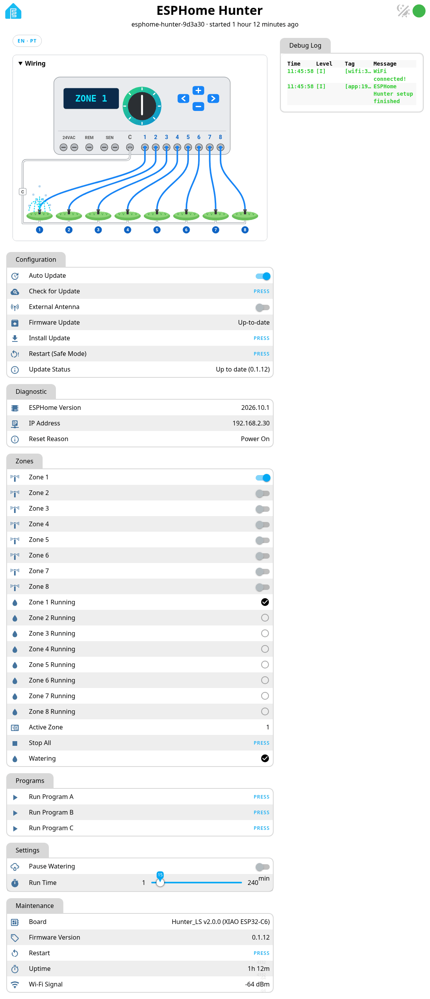
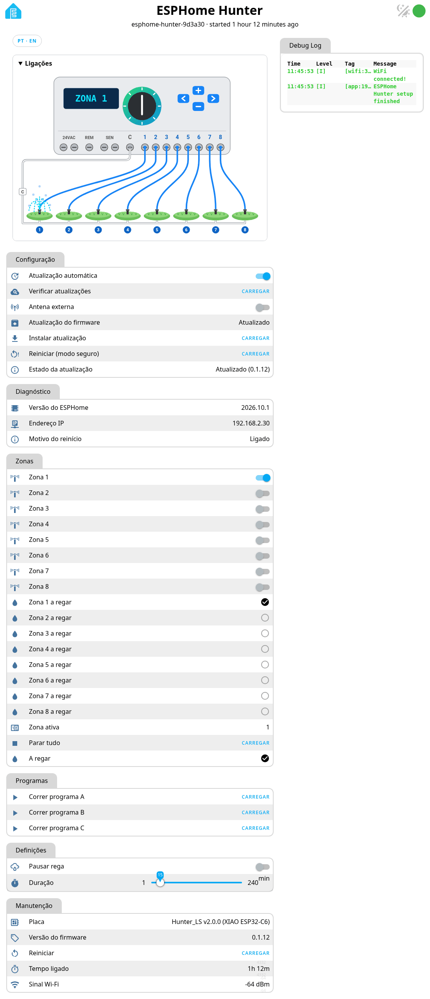

# Device web page

Open `http://<device-ip>/` on your LAN for the PT/EN toggle, a live X-Core wiring diagram and the
update controls (*Check for Update*, *Install Update*, *Auto Update*).
No password by design (LAN only) — see [security notes](security.md).

## Screenshots

  

  

