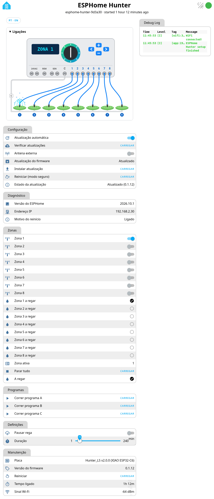
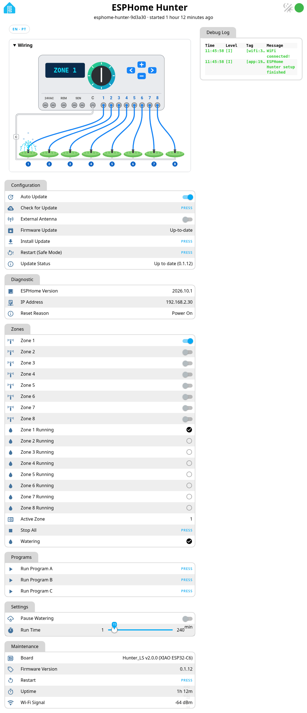

# Página web da placa

Abre `http://<ip-da-placa>/` na tua rede local para o botão PT/EN, um esquema de ligações do X-Core em direto e os botões de atualização (*Verificar atualizações*, *Instalar atualização*, *Atualização automática*).
Sem palavra-passe de propósito (só na LAN) — vê as [notas de segurança](security.md).

## Capturas

  

  

