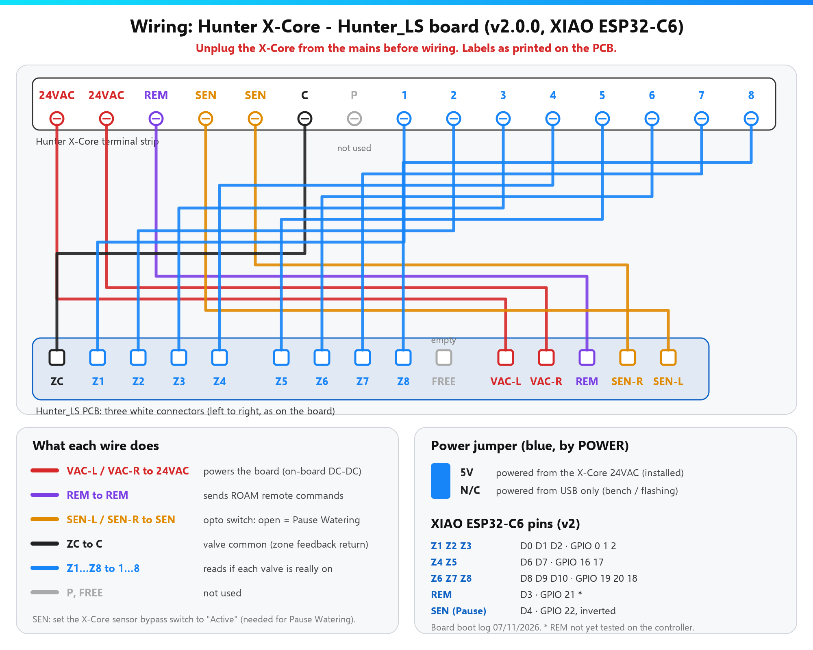

# Wiring

!!! danger "Mains voltage"
    Unplug the X-Core transformer from the mains before wiring. The board only touches the 24 V AC side.

## Diagram

## Where each wire goes

| Hunter_LS (PCB label) | X-Core terminal | What it does |
|---|---|---|
| VAC-L, VAC-R | 24VAC, 24VAC | Powers the board |
| REM | REM | ROAM remote commands |
| SEN-L, SEN-R | SEN, SEN | *Pause Watering* (set sensor switch to **Active**) |
| ZC | C | Valve common (feedback return) |
| Z1 … Z8 | 1 … 8 | Valve feedback (v1: Z1–Z4 only) |

**Power jumper** (blue): **5V** when installed in the X-Core; **N/C** for USB-only flashing.

## Fit steps

1. Unplug the X-Core transformer
2. Set the **sensor bypass switch to Active** (needed for *Pause Watering*)
3. Connect the wires following the board labels
4. Plug the transformer back in — the LED blinks until Wi-Fi is up

More pin detail: [hardware.md on GitHub](https://github.com/skydoy/ESPHOME_Hunter/blob/main/docs/hardware.md).
