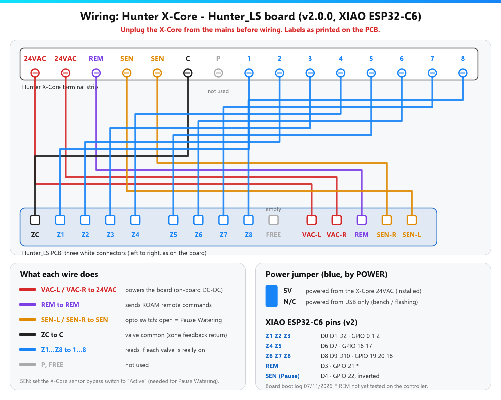

# Ligações

!!! danger "Tensão da rede"
    Desliga o transformador do X-Core da tomada antes de ligar os fios. A placa só toca no lado de 24 V AC.

## Esquema

## Onde vai cada fio

| Hunter_LS (legenda na PCB) | Terminal do X-Core | Para que serve |
|---|---|---|
| VAC-L, VAC-R | 24VAC, 24VAC | Alimenta a placa |
| REM | REM | Comandos do comando ROAM |
| SEN-L, SEN-R | SEN, SEN | *Pause Watering* (põe o interruptor do sensor em **Active**) |
| ZC | C | Comum das válvulas (retorno do feedback) |
| Z1 … Z8 | 1 … 8 | Feedback das válvulas (v1: só Z1–Z4) |

**Jumper de alimentação** (azul): **5V** com a placa no X-Core; **N/C** só para gravar por USB.

## Montar

1. Desliga o transformador do X-Core
2. Põe o **interruptor do sensor em Active** (necessário para a *Pause Watering*)
3. Liga os fios seguindo as legendas da placa
4. Volta a ligar o transformador — o LED pisca até haver Wi-Fi

Mais detalhe de pinos: [hardware.md no GitHub](https://github.com/skydoy/ESPHOME_Hunter/blob/main/docs/hardware.md).
